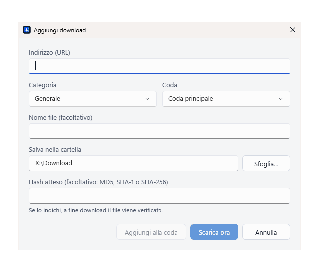

<p align="center">
  <picture>
    <source media="(prefers-color-scheme: dark)" srcset="docs/brand/kit/01_Logo_SVG/BATON_logo_orizzontale_bianco.svg">
    
  </picture>
</p>

<p align="center"><b>A fast segmented download manager for Windows</b></p>

<p align="center">
  <a href="https://github.com/AndreaAzzarello/baton/actions/workflows/ci.yml"></a>
  <a href="LICENSE"></a>
  <a href="https://github.com/AndreaAzzarello/baton/releases/latest"></a>
  <a href="https://github.com/AndreaAzzarello/baton/releases"></a>
  
</p>

<p align="center"><b>English</b> · <a href="README.it.md">Italiano</a></p>

| Light theme | Dark theme |
|---|---|
|  |  |

<p align="center"></p>

<p align="center"><i>Screenshots and animation made with test data.</i></p>

## Why Baton?

In a relay race the baton is passed from runner to runner; in Baton, connections hand pieces of a file to each other:
when one finishes its range it takes over half of the largest range still left (dynamic segmentation), so a download keeps every
connection busy until the end. Baton is open source (MIT), written from scratch, and has **no telemetry**: it talks only to
the servers you download from and, when you enable or ask for an update check, to this repository's releases. Updates are **signed** and verified
before they are installed, and passwords, cookies and form data are encrypted with Windows DPAPI, never written in clear.

## Features

- **Segmented downloads** with up to 32 connections (8 by default), dynamic segmentation, pause and resume (also after a restart).
- **Queues and scheduling**: named queues, days and hours, hourly quotas, wake timers, end-of-queue actions.
- **Categories** with their own folders; light, dark and system themes; notification-area icon.
- **HTTP/HTTPS, FTP/FTPS**, proxies (system, HTTP, SOCKS5, PAC) and authentication (Basic, Digest, NTLM, Negotiate).
- **HLS and DASH video** with quality, audio language and subtitles; merged into MP4 if you install ffmpeg.
- **Site grabber**: filtered files or an offline copy of static pages, respecting robots.txt, with sync and scheduling.
- **Browser integration** for Chrome, Edge, Opera, Brave and Firefox: captured downloads, context menu, forms (POST),
  "Download all", and a video button that can be closed, minimized or kept in the extension's menu.
- **File Explorer-style list**: multiple selection, drag files out, Del to remove, Shift+Del to send files to the Recycle Bin.
- **After the download**: optional hash check and antivirus scan.
- **Signed updates** (ECDSA P-256) with automatic rollback; settings export and import.

## Download & install

Requires Windows 10 (1809 or later) or Windows 11, x64. The .NET runtime is included and **no administrator rights** are
needed. Pick one:

| | How | Updates |
|---|---|---|
| **Installer** (recommended) | Download `Baton-Setup-<version>.exe` from **[Releases](https://github.com/AndreaAzzarello/baton/releases/latest)** and run it. It installs for your user only in `%LOCALAPPDATA%\Programs\Baton`, with a Start menu shortcut (Desktop optional) and an entry in **Settings › Apps › Installed apps** to uninstall. | in the app, or run a newer setup |
| **winget** (once the package is accepted) | `winget install AndreaAzzarello.Baton` | `winget upgrade AndreaAzzarello.Baton` |
| **Scoop** | `scoop bucket add baton https://github.com/AndreaAzzarello/scoop-baton`<br>`scoop install baton/baton` | `scoop update baton` |
| **Portable** | Extract `Baton-<version>-portable.zip` anywhere (also a USB stick) and run `Baton.exe`. | in the app |

The **portable** version keeps everything in the `Data` folder next to `Baton.exe` and writes nothing to the registry: it
only asks whether to register itself for the browser extension. It cannot start with Windows and shows completed
downloads in its notification-area icon instead of Windows notifications. Deleting `portable.flag` turns it into a normal
copy that uses `%LOCALAPPDATA%\Baton`.

**Uninstalling** (installer, winget) removes the program, its shortcuts and what it registered for browsers, `baton:`
links, notifications and start with Windows. It asks whether to keep your download list and settings (kept by default;
silent uninstalls always keep them); downloaded files are never deleted.

The installer finds earlier copies: data of a portable copy can be copied into the installed one, a copy that the browsers
or start with Windows pointed to is replaced in those registrations (and left on disk), and data of DownloadManager 1.1
is copied at the first start ([migration notes](README.it.md#da-downloadmanager-11-a-baton), Italian).

> [!NOTE]
> Until [SignPath Foundation](https://signpath.org/) approves the project for free code signing, the files are signed only
> with the project's release key, so Windows SmartScreen may warn you. After [verifying the release](#verify-a-release),
> choose **More info › Run anyway**. See the [code signing policy](docs/SIGNING.md).

## Language

The interface is in **English** and **Italian**. By default it follows Windows (Italian for an Italian Windows, English
for any other language); change it in **Settings › General › Language**, it applies at once. Dates, numbers and sizes
follow the chosen language. The browser extension follows the browser's language.

## Browser extension

Start Baton once first: it registers the native messaging host the extension talks to.

- **Chrome, Edge, Opera, Brave**: extract `baton-chromium-<version>.zip` from the release to a folder you will keep, open
  `chrome://extensions` (or `edge://`, `opera://`, `brave://`), turn on **Developer mode** and choose **Load unpacked**.
- **Firefox** (128 or later): the `.xpi` in the release is not signed by Mozilla, so regular Firefox loads it only as a
  temporary add-on (`about:debugging#/runtime/this-firefox` › **Load Temporary Add-on**). For a permanent install, sign it
  with your own AMO keys ([how](README.it.md#firefox-permanente-firma-non-elencata-su-addonsmozillaorg)) or use Firefox
  Developer Edition or Nightly.

In the extension's popup, **Check connection** tells you whether the app answers.

## Verify a release

`Baton.exe` and the installer each carry a SHA-256 hash (`.sha256`) and an ECDSA P-256 signature (`.sig`) of
"version + file name + SHA-256", made with a private key that never leaves the author's PC. The public keys are in
[`release-keys.txt`](src/Baton.Core/Updates/release-keys.txt): `b80f666050fcbc7d` (main) and `cc691630b30bf7f1` (spare).
Once SignPath signs the releases they also carry an Authenticode signature, made before the release key signs the final
file. From a clone of this repository:

```powershell
.\tools\verify-release.ps1 -Exe "$HOME\Downloads\Baton-Setup-1.3.0.exe"
# OK: Baton-Setup-1.3.0.exe 1.3.0, SHA-256 …, signed by b80f666050fcbc7d; no Authenticode signature.
```

`SHA256SUMS.txt` lists the hashes of every file of the release, also the portable zip and the extension packages.

Hash only, without cloning: `(Get-FileHash .\Baton.exe -Algorithm SHA256).Hash` must match the content of
`Baton.exe.sha256`. The hash proves the file is intact; the signature proves who made it. The app runs the same checks
before installing an update.

## Build from source

Requirements: .NET 10 SDK and Node.js (for the extension's tests).

```powershell
dotnet build Baton.slnx                                          # zero warnings expected
dotnet test Baton.slnx                                           # xUnit, WPF UI and extension tests
dotnet publish src\Baton.App -c Release -r win-x64 -o publish    # self-contained Baton.exe
node tools/build-extension.mjs                                   # dist\chromium, dist\firefox and their packages
.\tools\build-packages.ps1                                       # installer (Inno Setup 6) and portable zip
```

The SDK version is pinned in `global.json`, so the same commit gives the same `Baton.exe` (`-p:ContinuousIntegrationBuild=true`).
Releases are built by [`release.yml`](.github/workflows/release.yml); the release process is in [docs/SIGNING.md](docs/SIGNING.md).

To contribute, read [CONTRIBUTING.md](CONTRIBUTING.md).

## Known issues

- No SFTP; the grabber reads static HTML/CSS only (no JavaScript); subtitles are WebVTT only.
- The Firefox extension must be signed by the user ([details](README.it.md#limiti-noti-known-issues), Italian).
- Installed with Scoop, update with `scoop update baton`: the in-app updater works too, but Scoop then keeps showing the
  older version. The portable version cannot start with Windows.
- An internal security audit of 1.1.0 confirmed no vulnerabilities but left **8 leads to validate**, none reproduced yet.
  Reports are welcome through [SECURITY.md](SECURITY.md).

| # | Lead (unconfirmed) | Current mitigation |
|---|---|---|
| L1 | "Download all" forwards cookies of the chosen links' hosts (up to 50) | Needs a click and a confirmation; use it on sites you trust |
| L2 | "Update address" to another host could resend saved logins or form data | Credentials are bound to scheme, host and port; check the new address |
| L3 | A PAC script sees full https URLs and could leak them over DNS | Use trusted PAC files only (https or local) |
| L4 | Cross-site form POSTs under public suffixes missing from the built-in list skip the confirmation | Keep browser-download confirmation on |
| L5 | Shell file types (`.library-ms`, `.url`, `.scf`, `.lnk`, …) have no per-type policy | Files get the Internet mark (`Zone.Identifier`) |
| L6 | Offline copies may keep scripts in HTML saved with unusual extensions | Known scripts are removed; open copies in an up-to-date browser |
| L7 | A scheduled file grab may save server-chosen types (such as `.exe`) | Nothing is executed; check scheduled projects' folders |
| L8 | Imported settings with a relative category folder could target the Startup folder | Import only your own files; nothing is preselected |

## Documentation

- **[Full guide (Italian)](README.it.md)**: every feature, settings, data, performance, troubleshooting.
- [CHANGELOG.md](CHANGELOG.md) · [SECURITY.md](SECURITY.md) · [CONTRIBUTING.md](CONTRIBUTING.md) ·
  [Code of conduct](CODE_OF_CONDUCT.md)

**Translations welcome**: the texts of the app are a table of English and Italian pairs in
[`tools/make_resx.py`](tools/make_resx.py), those of the extension in [`tools/make_locales.py`](tools/make_locales.py)
(see CONTRIBUTING).

## Brand and license

The code is released under the [MIT license](LICENSE) © 2026 Andrea Azzarello. Third-party components:
[THIRD-PARTY-NOTICES.md](THIRD-PARTY-NOTICES.md). The Baton name, logo and icons ([`docs/brand/kit`](docs/brand/kit)) belong
to the project and **are not covered by the MIT license**: you may show them to refer to Baton, unmodified; derived
products should use a different name and logo. Baton is an independent project, not affiliated with any commercial product;
the extension's integration modes take only the idea, never the code, from "Download with…" (MPL 2.0).
